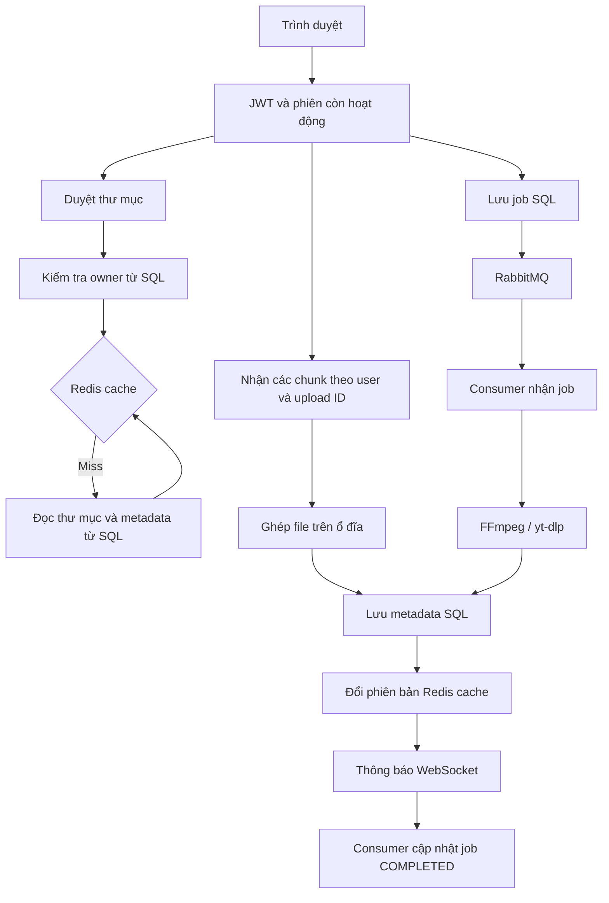

# Đánh giá luồng nghiệp vụ Media Cloud

Ngày rà soát: 25/10/2026 (Asia/Saigon).

**Cập nhật 26/10/2026:** các nhận định dưới đây mô tả phiên bản trước đợt sửa. Bản triển khai hiện tại đã bổ sung transaction/outbox, lease/finalization, UploadSession/resume, quota, validation/rate limit, phân trang/DTO, fan-out Redis và đối soát storage. Xem [hướng dẫn và phạm vi kiểm chứng](workflow-upgrade.md). Các probe cũ trong target là bằng chứng lịch sử; không dùng chúng làm kết luận về mã sau sửa.

## Phạm vi và kết luận

Rà soát working tree hiện tại, gồm giao diện mới, RabbitMQ và Redis. Các luồng chính đã có kiểm tra quyền sở hữu, JWT gắn với phiên, upload chia mảnh, timeout công cụ, retry/dead-letter và cache theo người dùng.

Ưu tiên tiếp theo là tính nhất quán giữa trạng thái job, message và file thực tế. Có 5 tình huống đã tái hiện bằng service thật cùng repository/công cụ media mô phỏng. Các nhận định về SQL Server thực tế và triển khai nhiều node được ghi rõ điều kiện, không coi là kết quả kiểm thử end-to-end.

Không thay đổi mã nghiệp vụ trong đợt rà soát này. Mã mô phỏng và kết quả nằm ở `target/logic-audit/BusinessFlowProbe.java` và `target/logic-audit/results.json` (thư mục bị Git bỏ qua).

## Bản đồ các luồng

| Luồng | Hành vi hiện tại | Điểm cần tập trung |
| --- | --- | --- |
| Đăng ký / đăng nhập | BCrypt, access/refresh cookie, bản ghi phiên trong SQL | Validation server, chính sách tài khoản, giới hạn thử đăng nhập |
| Refresh / logout | Refresh kiểm tra phiên; logout thu hồi session và phát sự kiện đóng WebSocket | Rotation/reuse policy; truyền sự kiện thu hồi khi có nhiều instance |
| Duyệt thư mục | Kiểm tra owner từ SQL, đọc Redis theo user/folder, miss thì truy vấn SQL | Phân trang, DTO, index và invalidation khi thao tác ngoài ứng dụng |
| Tạo / đổi tên / xóa thư mục | Kiểm tra owner, chỉ xóa thư mục trống, đổi phiên bản cache sau ghi thành công | Thư mục đang có job/upload; khóa ngoại và thao tác đồng thời |
| Upload | Chunk tối đa 5 MiB, manifest, quota tạm, ghép file rồi lưu metadata | Session upload bền vững, complete có thể gọi lại, resume, quota lưu trữ |
| YouTube / MP3 | Lưu job SQL, gửi RabbitMQ, consumer chạy công cụ, lưu file, thông báo tiến độ | Outbox, chống chạy trùng, finalization/hủy, quota job |
| Xem / tải / xóa file | Kiểm tra owner mới từ SQL; Range; giữ metadata khi xóa ổ đĩa thất bại | Quy tắc định dạng được xem inline và đối soát file/metadata khi crash |
| Tiến độ / khôi phục UI | STOMP riêng theo user; bảng tiến độ lưu trong bộ nhớ trang | Khôi phục sau reload/reconnect và phân biệt retry với thất bại cuối cùng |

Đối với job media, thứ tự hiện tại là lưu file/metadata → phát COMPLETED → cập nhật trạng thái job. Đây là một phần nguyên nhân các hệ thống có thể thấy kết quả khác nhau khi có hủy hoặc lỗi giữa các bước.

## Phát hiện ưu tiên

P1: cần xử lý trước khi dựa vào luồng này cho dữ liệu quan trọng hoặc mở rộng worker. P2: cần cho khả năng phục hồi, vận hành nhiều người dùng và hợp đồng API rõ ràng.

### G01 — P1: Lưu job và gửi RabbitMQ chưa có cơ chế phục hồi thống nhất

**Nguồn:** `MediaJobService.java:30–37`, `MediaJobConsumer.java:41`.

**Tình huống đã xác nhận:** giả lập publisher đã gửi message nhưng mất confirm. Service đánh dấu job `PUBLISH_FAILED`. Consumer nhận lại chính message đó, `start()` trả false và consumer kết thúc bình thường; engine không chạy. Với AUTO ack, delivery này được xác nhận thay vì tiếp tục xử lý.

Ngoài ra, tiến trình chết sau khi SQL đã lưu job và trước khi publish sẽ để lại job QUEUED không có message. Lưu SQL và publish hiện là hai thao tác riêng.

**Cải thiện:** lưu job và bản ghi outbox trong cùng SQL transaction; dispatcher gửi RabbitMQ, retry và đánh dấu đã gửi. Thêm idempotency key theo user/request để client gửi lại không tạo job mới. Phân biệt trạng thái chờ gửi với lỗi xử lý cuối cùng.

**Tiêu chí nghiệm thu:** gián đoạn trước/sau publish hoặc mất confirm không làm mất tác vụ; gửi lại cùng request trả về cùng job; redelivery không tạo thêm kết quả.

### G02 — P1: Hủy và hoàn tất job chưa được chốt trong một quy tắc nguyên tử

**Nguồn:** `MediaEngineService.java:80–88,137–142`, `MediaJobService.java:64–75`, `MediaJobConsumer.java:49`.

**Tình huống đã xác nhận:** yêu cầu hủy đến sau lần kiểm tra hủy cuối cùng và trước khi metadata được lưu. Kết quả mô phỏng: job = CANCELLED, có 1 file kết quả và metadata, WebSocket = COMPLETED. Việc không cho ghi đè CANCELLED ở bảng job không ngăn được ghi file/metadata.

**Cải thiện:** có bước finalization do service điều phối: kiểm tra quyền sở hữu lượt chạy và trạng thái hủy, lưu metadata và chuyển job COMPLETED trong cùng SQL transaction. Chỉ thông báo hoàn tất sau commit. Mỗi lượt chạy có file staging riêng; kết quả thua cuộc được dọn bù/đối soát.

**Tiêu chí nghiệm thu:** nếu hủy thắng thì không có kết quả được công bố; nếu hoàn tất thắng thì API hủy trả 409. API trạng thái và WebSocket phải thống nhất.

### G03 — P1 khi nhiều instance: Hai worker có thể nhận quyền chạy cùng job

**Nguồn:** `MediaJobService.java:55–57`, `MediaJobConsumer.java:18,35`, `MediaEngineService.java:74–75,122–123`.

**Tình huống đã xác nhận:** hai consumer object độc lập dùng chung repository mô phỏng đều chạy engine cho cùng job. `start()` chấp nhận cả RUNNING → RUNNING; mảng khóa chỉ thuộc từng consumer instance. Mô phỏng cho kết quả 2 lần chạy.

Đây không có nghĩa RabbitMQ luôn giao trùng: điều kiện là có delivery trùng/được giao lại trong khi worker cũ còn thực thi. Khi xảy ra, hai lượt dùng cùng đường dẫn kết quả và cleanup có thể ảnh hưởng nhau.

**Cải thiện:** nhận quyền chạy bằng cập nhật có điều kiện trong SQL, có worker ID, attempt ID, lease/heartbeat và cơ chế từ chối lượt chạy đã mất quyền. Chỉ nhận lại RUNNING khi lease cũ hết hạn. Tách đường dẫn file theo attempt và chỉ công bố một kết quả.

**Tiêu chí nghiệm thu:** hai worker tranh cùng job chỉ có một worker hợp lệ; worker mất lease không được ghi đè hoặc xóa kết quả của worker mới.

### G04 — P1 cần kiểm chứng với schema thật: Xóa thư mục trong khi job/upload còn đang tạo nội dung

**Nguồn:** `FolderService.java:56–73`, `MediaEngineService.java:118–138`, `MediaService.java:104–135`, các trường ID trong `Folder.java` và `MediaFile.java`.

YouTube chỉ kiểm tra thư mục trước khi chạy công cụ. Một thư mục đang trống có thể bị xóa trong lúc video đang tải. Worker sau đó vẫn lưu `folderId` cũ. Upload cũng kiểm tra parent trước khi ghép/lưu. Entity hiện dùng ID dạng chuỗi, không khai báo quan hệ/foreign key; không tìm thấy migration trong repository.

Nếu database không có khóa ngoại ngoài mã nguồn, có thể tạo metadata trỏ tới thư mục đã xóa. Nếu có khóa ngoại, job sẽ lỗi ở cuối sau khi đã tốn thời gian xử lý. Chưa truy cập schema SQL Server thực tế để xác định trường hợp nào đang áp dụng.

**Cải thiện:** chốt quy tắc không xóa thư mục đang có upload/job hoạt động; kiểm tra đồng thời bằng transaction/khóa thích hợp. Có migration cho FK file–folder và folder–parent, chính sách xóa rõ ràng; kiểm tra lại parent tại finalization.

**Tiêu chí nghiệm thu:** chạy đồng thời xóa thư mục và hoàn tất upload/job luôn có một kết quả nghiệp vụ xác định, không có file bị mất khỏi cây thư mục.

### G05 — P2: Complete upload chưa có tính idempotent và chưa resume được

**Nguồn:** `MediaService.java:99–152`, `app.js:831–862`.

**Tình huống đã xác nhận:** merge lần đầu lưu file thành công và dọn chunk; gọi lại cùng upload ID bị lỗi không tìm thấy upload, thay vì trả file đã tạo. Khi response đầu tiên bị mất, client không biết việc upload đã thành công. Nếu cleanup chưa hoàn tất, một lần merge khác còn có thể tạo UUID/file mới từ cùng dữ liệu.

Frontend cũng sinh upload ID mới mỗi lần chọn tệp và không có endpoint truy vấn các chunk đã nhận.

**Cải thiện:** lưu UploadSession với unique key `(userId, uploadId)`, trạng thái, tổng byte/chunk và resultFileId; complete lặp lại trả cùng kết quả. Thêm endpoint status/resume và xác minh kích thước/hash khi hoàn tất.

**Tiêu chí nghiệm thu:** mất response, reload hoặc retry không tạo file trùng; có thể tiếp tục phần còn thiếu của upload.

### G06 — P2: Validation nghiệp vụ ở server chưa đầy đủ

**Nguồn:** `UserService.java:23–36`, `FolderService.java:23,49`, `FileService.java:137`, các request kiểu Map.

**Tình huống đã xác nhận:** service đăng ký chấp nhận username toàn khoảng trắng và băm mật khẩu rỗng trước khi gọi repository. Giao diện chặn một phần trường hợp nhưng API có thể gọi trực tiếp. Chưa xác nhận insert các giá trị này trên SQL Server thật.

Tên tài khoản trong giao diện cho tối đa 100 ký tự trong khi entity là 50. Tên thư mục/tệp khi đổi tên chưa có cùng quy tắc với upload. Lỗi constraint có thể bị trả như lỗi server hoặc lộ thông báo tầng database.

**Cải thiện:** dùng request DTO có validation; chuẩn hóa username ở service; chốt chính sách mật khẩu, độ dài và tên tệp/thư mục. Xử lý duplicate bằng constraint + mã lỗi nghiệp vụ. Bổ sung giới hạn thử đăng nhập/đăng ký theo IP/tài khoản trong ứng dụng hoặc tầng cổng truy cập đã được kiểm chứng.

**Tiêu chí nghiệm thu:** dữ liệu thiếu/trắng/quá dài bị từ chối trước repository với mã lỗi ổn định; không cần dựa vào validation trình duyệt.

### G07 — P2: Chưa có quota lưu trữ lâu dài và giới hạn job theo tài khoản

**Nguồn:** `MediaService.java:172–191`, `FileService.java:38`, `MediaJobService.java:22–33`, `application.properties:30–37,51–52`.

Đã có giới hạn upload tạm, số upload đang mở, kích thước YouTube và concurrency worker toàn ứng dụng. Chưa thấy hạn mức tổng dung lượng đã lưu, byte đang được dành trước hoặc số job QUEUED/RUNNING của mỗi tài khoản.

Một người dùng có thể tích lũy tệp hoặc xếp nhiều tác vụ liên tục; các giới hạn hiện tại không bảo đảm dung lượng ổ đĩa và thời gian chờ công bằng giữa người dùng.

**Cải thiện:** quota có reservation trong transaction trước khi nhận upload/job; tính cả đầu ra MP3/video và thu hồi reservation khi thất bại/hủy. Giới hạn job chờ/đang chạy theo user, có tín hiệu 413/429 phù hợp và cảnh báo dung lượng hệ thống.

### G08 — P2: Tiến độ chưa khôi phục đầy đủ sau reload/reconnect

**Nguồn:** `app.js:34,132–153,239–257`, `MediaJobController.java:17`, `MediaJob.java`.

Bảng tiến độ nằm trong Map của trang. Sau reconnect, client chỉ subscribe sự kiện mới; không tải lại danh sách job hoạt động. Nếu mất thông báo cuối cùng, UI có thể giữ trạng thái chờ hoặc không còn biết job. Backend có GET theo ID nhưng chưa có API liệt kê job để khôi phục khi ID đã mất.

FAILED hiện vừa xuất hiện trước retry vừa là lỗi cuối. Job chưa có attempt count, tiến độ bền vững hoặc nguyên nhân thất bại an toàn cho người dùng.

**Cải thiện:** có API lịch sử/job đang chạy theo owner; tải lại khi đăng nhập/reconnect và polling dự phòng theo ID. Phân biệt RETRYING với FAILED cuối cùng, lưu attempt/progress/error code và thời điểm cập nhật.

### G09 — P2 trước khi chạy nhiều node: Storage và thông báo còn gắn với từng tiến trình

**Nguồn:** `MediaEngineService.java:169–185`, `WebSocketConfig.java:33`, `AuthenticatedWebSocketSessions.java:16,53`.

Storage hiện là đường dẫn cục bộ và thông báo dùng simple broker; danh sách socket và sự kiện thu hồi phiên nằm trong từng JVM. Nếu worker và socket người dùng ở hai node khác nhau, cấu hình này chưa có đường truyền thông báo giữa chúng. Worker cũng cần đọc được file đã upload ở node khác.

Suy luận này dựa trên cấu hình dự án và việc simple broker lưu subscription trong bộ nhớ theo [tài liệu Spring](https://docs.spring.io/spring-framework/reference/web/websocket/stomp/handle-simple-broker.html). Chưa chạy kiểm thử hệ thống nhiều container.

**Cải thiện:** storage dùng chung/object storage; broker relay hoặc cơ chế fan-out có định tuyến user giữa các node; truyền sự kiện revoke qua kênh phân tán và kiểm tra thời hạn socket. Kiểm thử riêng bài toán A upload, B xử lý, A nhận tiến độ.

### G10 — P2: Hợp đồng API và quy mô dữ liệu cần được chuẩn hóa

**Nguồn:** `DriveListingService.java:22–30`, `MediaFile.java:72`, `FolderController.java`, `FileController.java`.

Danh sách trả trực tiếp entity, bao gồm getter `storagePath`; client không cần biết đường dẫn vật lý server. Truy vấn lấy toàn bộ danh sách, frontend tìm/sắp xếp trên tập đã tải. Khi thư mục lớn, payload, DOM và truy vấn vẫn tăng; entry vượt 2 MiB còn được chủ động bỏ qua cache.

Một số endpoint bắt mọi RuntimeException và biến thành 404/400, khiến lỗi hạ tầng khó phân biệt với sai dữ liệu hoặc không có quyền.

**Cải thiện:** response DTO chỉ chứa thông tin public; phân trang cùng tìm kiếm/sort trên server và index ghép theo user/folder. Dùng domain exception và error code thống nhất, giữ khác biệt giữa 400/401/403/404/409/413/429/503. Quản lý schema bằng migration thay cho phụ thuộc hoàn toàn vào ddl-auto=update.

### G11 — P2: Cần đối soát file, metadata và tác vụ sau sự cố tiến trình

**Nguồn:** `FileService.java:119–135`, `MediaService.java:123–150`, `MediaEngineService.java:189`.

Các nhánh lỗi thông thường đã có cleanup và retry. Tuy nhiên, JVM/host chết giữa thao tác file và SQL không chạy được catch/finally. Xóa file rồi chết trước khi xóa metadata có thể để lại bản ghi trỏ tới file không còn; tạo output rồi chết trước khi lưu metadata có thể để lại file rác.

**Cải thiện:** có trạng thái/quy trình xóa bền vững, output staging theo attempt, tác vụ đối soát và cleanup định kỳ có điều kiện an toàn. Không chỉ dựa vào finally. Kết hợp với lease để nhận diện job RUNNING hết hạn và phục hồi có kiểm soát.

## Kiểm chứng đã thực hiện

Các kết quả dưới đây là mô phỏng có kiểm soát, không phải sự cố trên dữ liệu thật:

| Mô phỏng | Kết quả quan sát |
| --- | --- |
| Broker giữ message, publisher báo mất confirm | PUBLISH_FAILED; consumer kết thúc; 0 lần chạy engine |
| Hủy ở thời điểm save metadata | CANCELLED trong job; có file/metadata; WebSocket báo COMPLETED |
| Hai consumer độc lập tranh cùng job | 2 lần chạy engine |
| Gọi lại merge sau lần đầu thành công | File đầu tiên tồn tại; lần gọi lại bị từ chối |
| Username trắng, mật khẩu rỗng | Service tạo hash và gọi lưu repository |

Đợt kiểm thử trước đó ghi nhận 83 test backend, 2 skipped, 0 failure/error; trong số test đã chạy có 6 test Redis thật. Đợt rà soát này bổ sung 5 mô phỏng ở trên, không chạy lại toàn bộ suite vì không sửa logic. Bộ test hiện tại chưa chứng minh transaction/foreign key/collation trên SQL Server thật, failover nhiều node hoặc crash giữa filesystem và database.

Không kết luận lỗi “email NULL chỉ đăng ký được một tài khoản” chỉ từ annotation unique: đã kiểm tra SQLServerDialect của Hibernate 6.5.2 trong dependency, có AlterTableUniqueIndexDelegate và nhánh sinh filtered index cho nullable column. Muốn đánh giá trường hợp này cần đối chiếu schema thật.

## Thứ tự cải thiện đề xuất

1. Chốt state machine và finalization của job; triển khai claim/lease và chống kết quả trùng. Bổ sung regression cho G02/G03.
2. Thêm outbox và idempotency key; kiểm thử mất confirm/crash trước và sau publish cho G01.
3. Làm UploadSession có complete/resume, xử lý thư mục đang bận và quota có reservation; bổ sung validation API.
4. Chuẩn hóa schema/FK/index, DTO và phân trang; thêm test tích hợp SQL Server, gồm Unicode và thao tác đồng thời.
5. Khôi phục tiến độ/lịch sử job, đối soát dữ liệu sau crash; hoàn thiện storage/notification phân tán trước khi mở rộng nhiều node.
